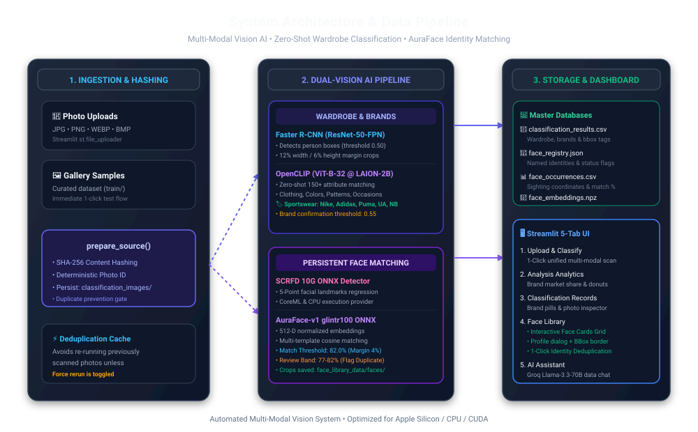
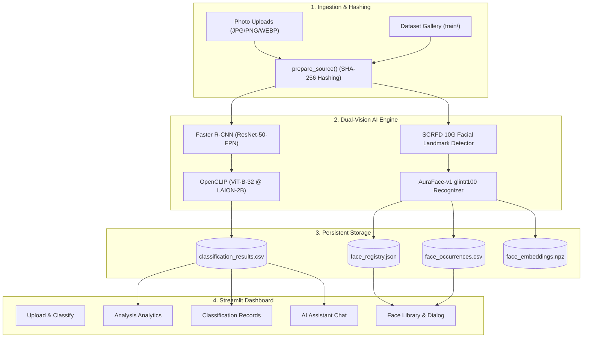
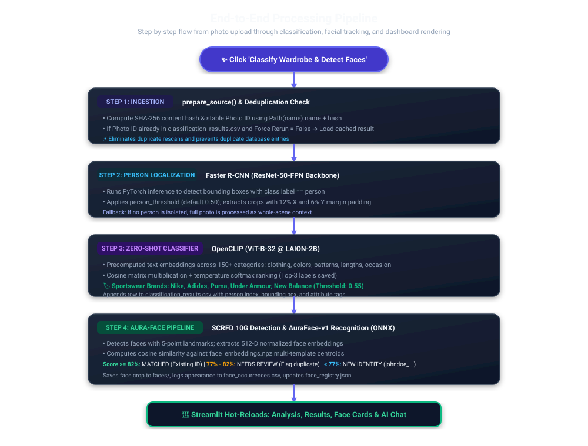
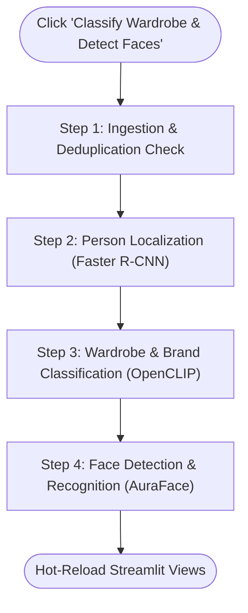

# Wardrobe & Brand Intelligence with Persistent Face Recognition

A multi-modal computer vision dashboard and analytics platform built with Streamlit, PyTorch, OpenCLIP, and AuraFace. It automatically localizes people in images, zero-shot classifies clothing styles, colors, and sportswear brands, and maps recurring individuals across photos into a persistent face identity library.

---

## 1. System Architecture



<details>
<summary><b>Click to expand Mermaid source text</b></summary>



</details>

---

## 2. End-to-End Processing Flowchart



<details>
<summary><b>Click to expand Mermaid source text</b></summary>



</details>

---

## 3. Key AI Models & Specifications

| Pipeline Stage | Model Architecture | Pretrained Source / Backbone | Key Technical Parameters |
| :--- | :--- | :--- | :--- |
| **Person Detection** | **Faster R-CNN** | `ResNet-50-FPN` (TorchVision) | Default sensitivity `0.50`, 12% width / 6% height margin crops |
| **Wardrobe Classification** | **OpenCLIP** | `ViT-B-32` (`laion2b_s34b_b79k`) | Zero-shot cosine similarity, temperature scaling, top-3 attributes |
| **Brand Recognition** | **OpenCLIP** | `ViT-B-32` (`laion2b_s34b_b79k`) | Tuned brand threshold `0.55` (Nike, Adidas, Puma, UA, New Balance) |
| **Face Detection** | **SCRFD 10G** | InsightFace ONNX (`scrfd_10g_bnkps.onnx`) | Detection size `(1024, 1024)`, 5-point facial landmark regression |
| **Face Recognition** | **AuraFace-v1** | `glintr100.onnx` (`fal/AuraFace-v1`) | 512-D normalized embeddings, `82.0%` match threshold, `4.0%` margin |
| **AI Assistant** | **Llama 3.3 70B** | Groq Cloud API | Natural language querying over structured dataset context |

---

## 4. Quick Start & Running Locally

```bash
# 1. Activate python virtual environment
source .venv/bin/activate

# 2. Run the Streamlit application
streamlit run code/classifier.py
```
Open **http://localhost:8501** in your browser.
